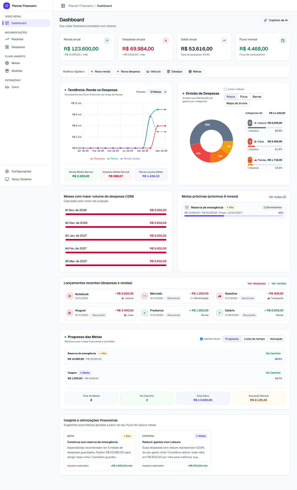
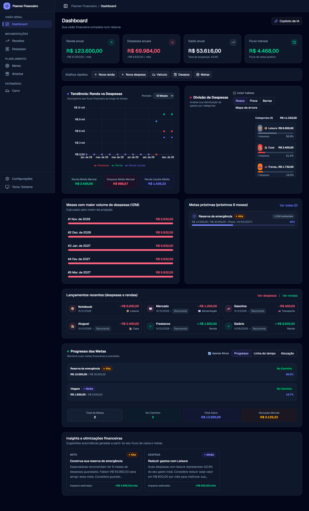
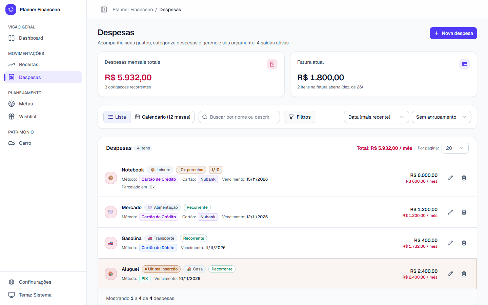
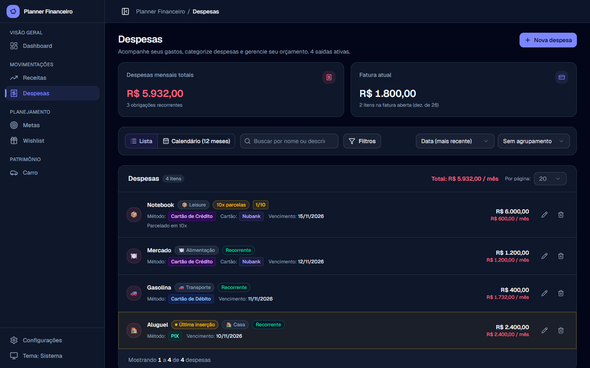
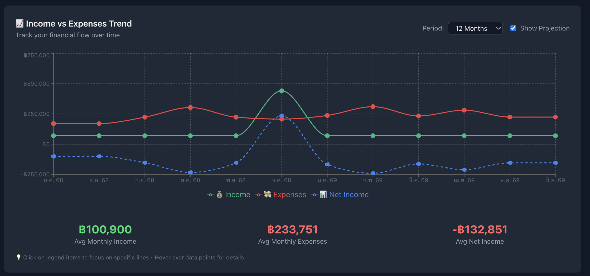
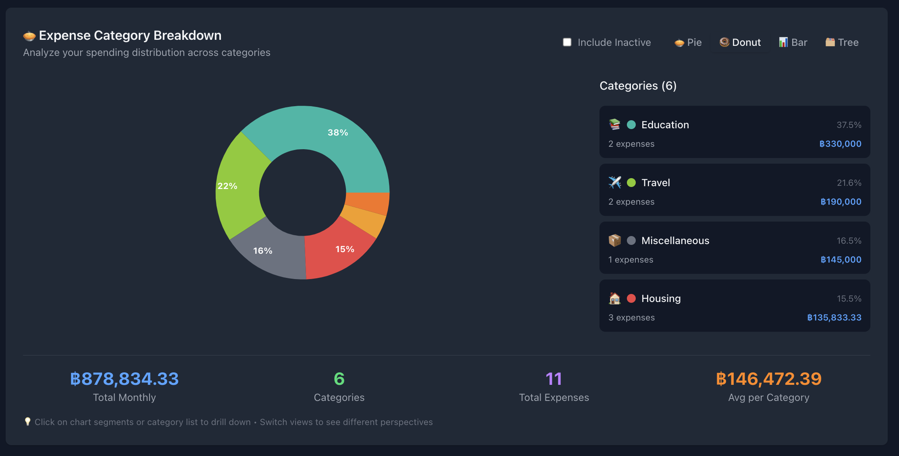
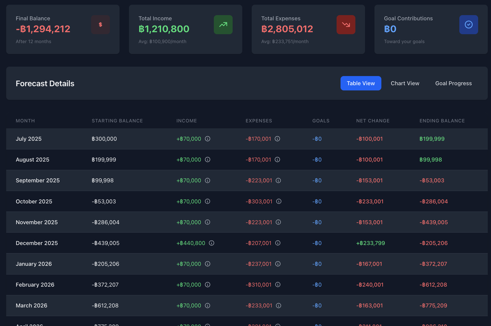

# Personal Finance Planner

> **Note:** This is a fun personal project made to solve my own pain in planning my financial situation. Built over a weekend, 100% of code are built by AI using [Cursor](https://cursor.com/), Claude 4 Sonnet, and [Taskmaster](https://github.com/eyaltoledano/claude-task-master). **Hope this helps anyone!**

[](https://nextjs.org/) [](https://react.dev/) [](https://tailwindcss.com/) [](https://www.typescriptlang.org/) [](https://recharts.org/)

---



<p align="center"><i>📸 Dashboard: Your complete financial overview at a glance</i></p>

## 📷 Screenshots



<p align="center"><i>Dashboard in the dark theme (sample data)</i></p>





<p align="center"><i>Expenses: list with filters, grouping and the new-expense modal (sample data)</i></p>



<p align="center"><i>Income vs Expenses Trend: Track your financial flow over time</i></p>



<p align="center"><i>Expense Category Breakdown: Analyze your spending distribution across categories</i></p>



<p align="center"><i>Forecast Table: See your projected balances month by month</i></p>

A modern, open-source personal finance planning app to help you manage your income, expenses, goals, and forecast your financial future. Built with Next.js, React, Tailwind CSS, TypeScript, and Recharts. The interface is in Brazilian Portuguese (pt-BR) and desktop-first, with a collapsible sidebar and a layout that works down to 390px wide. Values are in Brazilian reais (BRL). Includes light/dark/system themes and robust data persistence.

---

## 🆕 Latest Release Features

**New in this release:**
- **📅 Enhanced Expense Calendar View**: Navigate expenses with a visual monthly calendar, similar to the goal planning module
- **⚙️ Advanced Expense Management**: Sort and group expenses by type, date, and category for better organization
- **🔄 Custom Weekly Recurring**: Set custom weekly intervals (e.g., "every 2 weeks") for recurring expenses with full installment compatibility
- **📊 Forecast Calendar View**: Switch between table and calendar views in the forecast module for better visualization
- **🔧 Centralized Installment Logic**: Improved reliability for complex overlapping installment cycles across the entire application

---

## 🚀 Features

- **Dashboard Overview**: Get a high-level summary of your financial situation, including annual income, expenses, net income, savings rate, top expense categories, and upcoming goals, plus the current-period budget card.
- **Monthly Budget**: Set a budget per period with a custom rollover day (e.g. day 20 to 19), see spent vs. committed, reserve part of it for opt-in goals, get 80%/100% alerts, and confirm the savings contribution to your goals when a period closes. Rules in [`docs/BUDGET_LOGIC.md`](docs/BUDGET_LOGIC.md).
- **Income Management**: Add, edit, and track multiple income sources with support for recurring, one-time, and time-bound income.
- **Advanced Expense Tracking**: Manage recurring and one-time expenses with advanced sorting, grouping, calendar view, custom weekly frequencies, and sophisticated installment payment handling.
- **Financial Goals**: Set, track, and prioritize financial goals with progress tracking, forecast-based completion dates, and smart allocation.
- **Goal Planning & Allocation**: Visualize and plan monthly goal allocations with calendar, table, and chart views. Get actionable guidance for achieving your goals.
- **Enhanced Financial Forecasting**: Generate multi-year projections with both table and calendar views. Adjust starting balance, forecast period, and see the impact of your plans with improved visualization options.
- **Data Visualization**: Interactive charts for income vs. expenses, expense categories, and goal progress using Recharts.
- **Brazilian Real (BRL)**: All values are shown in reais with pt-BR formatting.
- **Portuguese (pt-BR) interface**: All UI text is in Brazilian Portuguese.
- **Light/Dark/System Theme**: Pick light, dark or follow your operating system, with no flash on load.
- **Sidebar Navigation**: Collapsible sidebar on desktop (Ctrl+B) and a drawer on mobile.
- **Data Persistence**: Your plan is saved to MySQL through the backend API. Import/export your full plan as JSON or CSV.
- **Settings Persistence**: The theme preference is saved in the browser.
- **Responsive**: Desktop-first layout that works from 390px up, without horizontal scrolling.
- **Accessible & Modern UI**: Built with accessibility and UX best practices.

---

## 🏗️ Project Structure

The repository is split into two independent npm projects plus documentation:

```
planner_financeiro/
├── backend/                 # REST API — Express 5 + TypeScript + MySQL (port 3001)
│   ├── src/
│   │   ├── server.ts        # Express app: /api/health, /api/plan, /api/car, /api/wishlist
│   │   ├── routes/          # One router per resource
│   │   ├── db/connection.ts # mysql2 connection pool
│   │   ├── domain/          # Business rules needed server-side (copy of frontend rules)
│   │   └── types/           # Copy of frontend/types/index.ts — keep in sync
│   ├── database/
│   │   ├── schema.sql       # Full schema (DDL only)
│   │   ├── migrations/      # Incremental migrations
│   │   └── seeds/local/     # Local dumps/exports with personal data (git-ignored)
│   └── scripts/apply-migration.ts
├── frontend/                # Next.js 15 App Router UI (port 3000)
│   ├── app/                 # Pages: dashboard, income, expenses, goals, car, wishlist, settings
│   ├── components/          # ui/ (shadcn), common/ (shared), layout/ (shell), <feature>/ per page
│   ├── context/  hooks/  lib/  types/  utils/
│   └── tests/               # Forecast calculator test cases
├── docs/                    # Business logic, product docs and screenshots
└── start-dev.ps1            # Starts backend + frontend for local development
```

The frontend calls relative URLs such as `fetch("/api/plan/")`. Next.js proxies every `/api/*` request to the backend (see `rewrites` in `frontend/next.config.ts`), so no CORS setup is needed. The target is `BACKEND_URL` (default `http://localhost:3001`).

---

## 📦 Tech Stack

- **Frontend**: Next.js 15 (App Router), React 19, TypeScript, Tailwind CSS 4, shadcn/ui (Radix), sonner (toasts), lucide-react (icons), Recharts
- **Backend**: Node.js 20+, Express 5, TypeScript (run with `tsx` in dev), mysql2
- **Database**: MySQL 8

---

## 🛠️ Getting Started

### Prerequisites

- Node.js 20 or newer
- MySQL 8 running locally (or reachable over the network)
- Windows PowerShell 5.1+ or PowerShell 7 (for `start-dev.ps1`)

### 1. Create the database

```bash
mysql -u root -p < backend/database/schema.sql
```

`schema.sql` creates the `finance_planner` database and every table. To apply a single migration later:

```bash
cd backend
npm run db:migrate -- wishlist_migration.sql
```

Existing databases need the monthly budget migration (idempotent: safe to run more than once; the backend also creates the missing columns/tables on the first `GET`/`POST /api/plan`):

```bash
cd backend
npm run db:migrate -- budget_migration.sql
```

### 2. Configure environment variables

```powershell
Copy-Item backend/.env.example backend/.env          # then fill in DB_HOST, DB_USER, DB_PASSWORD, DB_NAME
Copy-Item frontend/.env.example frontend/.env.local  # optional: start-dev.ps1 creates it
```

### 3. Start everything (recommended)

From the repository root:

```powershell
powershell -ExecutionPolicy Bypass -File .\start-dev.ps1
```

The script checks Node/npm, installs missing dependencies, validates the `.env` files, checks MySQL and the ports, and then opens two windows:

- **Backend**: `http://localhost:3001` (health check: `/api/health`)
- **Frontend**: [http://localhost:3000](http://localhost:3000)

Options: `-Install` (force `npm install`), `-SkipDbCheck`, `-BackendPort 3001`, `-FrontendPort 3000`.

### 4. Or run each side manually

```bash
# terminal 1
cd backend
npm install
npm run dev

# terminal 2
cd frontend
npm install
npm run dev
```

### 5. Build for production

```bash
cd backend && npm run build && npm start      # serves dist/server.js
cd frontend && npm run build && npm start     # set BACKEND_URL if the API is not on localhost:3001
```

### Useful scripts

| Folder | Script | Description |
|---|---|---|
| backend | `npm run dev` | API with hot reload (`tsx watch`) |
| backend | `npm run typecheck` / `npm run build` | Type-check / compile to `dist/` |
| backend | `npm test` | Unit tests (`node:test` via `tsx`) |
| backend | `npm run db:migrate -- <file.sql>` | Apply a SQL file from `database/migrations/` |
| frontend | `npm run dev` | Next.js dev server |
| frontend | `npm run typecheck` / `npm run lint` / `npm run build` | Quality checks and production build |
| frontend | `npm test` | Unit tests (`node:test` via `tsx`; budget engine, dates, mappers) |

---

## 🧩 Core Data Models

- **Income**: name, amount, frequency, start/end date, isActive
- **Expense**: name, amount, category, due date, recurring, frequency (including custom weekly intervals), priority, isActive, advanced installment options with overlap detection
- **Goal**: name, target amount, target date, current amount, category, priority, isActive, type (fixed/open-ended), priority order, optional monthly-budget reserve (`reserveFromBudget`, `budgetReserveOverride`)
- **Budget**: enabled, rollover day, amount history (value per period start) and period closures (`UserPlan.budget`)
- **Forecast**: month, projected balance, income, expenses, goal contributions
- **UserPlan**: All user data (income, expenses, goals, forecast, config, current balance)

See [`frontend/types/index.ts`](frontend/types/index.ts) for full TypeScript interfaces.

---

## 📊 Major Modules & Pages

- **Dashboard**: Overview, stats, charts, upcoming goals, current-period budget card
- **Budget** (`/budget`): Monthly budget with rollover day, spent vs. committed, income × expenses × goals, category breakdown, 12-period history and period closing
- **Income**: Add/edit/manage income sources
- **Expenses**: Advanced expense management with sorting, grouping, calendar view, and custom weekly recurring options
- **Goals**: Set, track, and prioritize goals
- **Goal Planning**: Monthly allocation breakdown, calendar, export
- **Forecast**: Multi-year projections with table and calendar views, starting balance, scenario planning
- **Import/Export**: Backup and restore your plan (JSON/CSV)
- **Settings**: Budget, categories (drag and drop to reorder), credit cards, import/export and appearance

---

## 🌐 Localization & Internationalization

- **Language**: Brazilian Portuguese (pt-BR) only
- **Currency**: Brazilian real (BRL)
- **Theme**: Light and dark modes
- **Settings**: All preferences are saved and included in import/export

---

## 🔒 Data Persistence & Security

- Your financial plan is stored in your own MySQL database through the local backend API
- The theme preference is kept in the browser's localStorage
- Import/export your full plan for backup or migration: JSON is the technical backup; CSV is in pt-BR (`;` delimiter, DD/MM/YYYY dates, decimal comma) and older English CSV/JSON files can still be imported
- Database dumps and exports belong in `backend/database/seeds/local/`, which is git-ignored, so personal data never gets committed
- Secrets live in `backend/.env` (git-ignored). Only `.env.example` templates are committed

---

## 📈 Data Visualization

- Interactive charts for income vs. expenses, expense categories, and goal progress
- Drill-down, tooltips, and multiple view modes
- Built with [Recharts](https://recharts.org/)

---

## 🧑‍💻 Contributing

Contributions are welcome! Please open issues or pull requests for bugs, features, or improvements.

---

## 🔗 Links

- [This repository](https://github.com/leofiorese/planner_financeiro)
- [Original project (oofangoo/personal-finance-planner)](https://github.com/oofangoo/personal-finance-planner)
- [LinkedIn (Thunyut Chienpairoj), original author](https://www.linkedin.com/in/thunyut/)
- Business logic documentation: [`docs/`](docs/)

---

## 📄 License

MIT License. See [LICENSE](LICENSE) for details.
